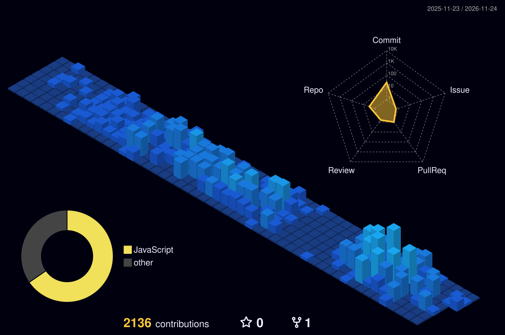

<div align="center">


[](https://www.mgoyeghiaian.com/)

**28+ Projects Worldwide**

[](https://www.mgoyeghiaian.com/)
[](mailto:info@mgoyeghiaian.com)

</div>

## About Me

Full-Stack Web Developer focused on scalable, secure and performance-driven digital experiences. I develop modern websites, mobile and Windows applications, combining frontend engineering, backend architecture and thoughtful design.

```typescript
const developer = {
  name: "Mgo Yeghiaian",
  role: "Full-Stack Web Developer",
  focus: ["Web", "Mobile", "Desktop"],
  principles: ["Performance", "Security", "Scalability"],
  philosophy: "I build digital identity through code."
};
```

## Areas of Expertise

| Frontend Engineering | Backend & APIs | Mobile & Systems |
| :--- | :--- | :--- |
| Responsive interfaces | REST APIs | Cross-platform apps |
| Component architecture | Authentication | Windows applications |
| UI/UX implementation | Database integration | Performance |

## Technical Expertise

### Languages & Core


JSON

### Frontend


Framer Motion

### Backend & APIs


REST API · JWT · Axios · Nodemailer · Amazon SQS

### Mobile & Systems


React Native

### Databases & ORM


Mongoose · pgAdmin · MongoDB Compass

### DevOps & Hosting


Apache · cPanel · FileZilla · Laravel Herd

### Design & CMS


Elementor · SEO

### Tools & Testing


QA Testing · Blackbox Testing

## GitHub Statistics

<div align="center">


</div>

## Developer Analytics

<div align="center">


</div>

## GitHub Achievements


## Contribution Activity


## 3D Contribution Calendar



## Pac-Man Contribution Animation

<picture>
  <source media="(prefers-color-scheme: dark)" srcset="./dist/pacman-contribution-graph-dark.svg"/>
  <source media="(prefers-color-scheme: light)" srcset="./dist/pacman-contribution-graph.svg"/>
  
</picture>

<div align="center">


**Code with purpose. Build with precision.**


</div>
